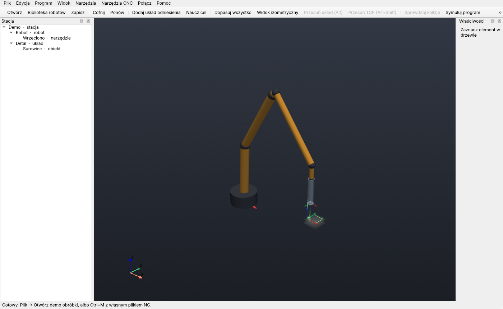
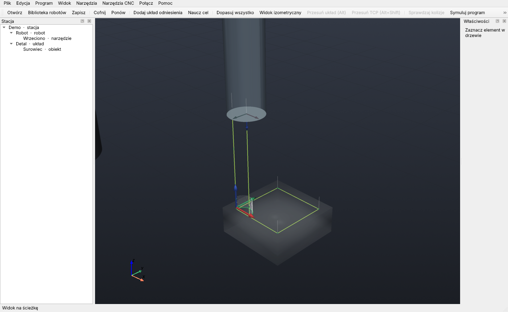

# roboCODE

Otwarte narzędzie do **programowania robotów offline (OLP)** i **obróbki robotem**: z pliku G-code
powstaje sprawdzony program dla kontrolera KUKA (KRL) lub ABB (RAPID). Wyróżnik w dalszej
kolejności: frezowanie kooperatywne dwoma ramionami (jedno trzyma detal, drugie wrzeciono).

> **Wymagania, konwencje, architektura, roadmapa i stan prac są w jednym dokumencie:
> [`docs/SPECYFIKACJA.md`](docs/SPECYFIKACJA.md).** W razie rozbieżności obowiązuje ten plik.
> Co zrobione i co dalej (kolejka prac): [`docs/ROADMAP.txt`](docs/ROADMAP.txt).
> Bot programujący: przeczytaj go w całości przed pierwszą zmianą, zwłaszcza §2 (zasady), §3 (decyzje)
> i §4 (konwencje).

## Stan: proof of concept 0.2 (jeden robot, pełny przepływ)

```
plik NC ─► parser (stan modalny, tryb ścisły) ─► solver (obrót Z, najazd/odjazd)
        ─► walidacja całej trajektorii ─► KRL/RAPID w pamięci ─► odczyt zwrotny poz
        ─► zapis atomowy pliku + manifest.json (raport, wersje, sumy SHA-256)
```
Błąd krytyczny na którymkolwiek etapie = **brak pliku dla robota** i raport wskazujący linię NC.

## Launcher dla Windows (roboCODE.exe)

1. Dwuklik **`build_exe.bat`**: tworzy `.venv` (jeśli go nie ma), instaluje zależności i PyInstaller,
   buduje **`roboCODE.exe`** w folderze projektu (około 23 MB, jeden plik, bez GUI Qt).
2. Dwuklik **`roboCODE.exe`** → menu: demo, obróbka własnego pliku NC (okno wyboru pliku), raport HTML,
   przykładowe pliki NC, folder wyników. Wyniki trafiają do folderu `out` obok exe.
3. `roboCODE.exe machine plik.nc --post abb` działa jak CLI. Bez budowania: dwuklik `roboCODE.bat`.

## Szybki start

```bash
pip install -e .[dev]          # z GUI: pip install -e .[dev,gui]
pytest
python -m robocode.cli demo                                         # demo → out/Machining.src
python -m robocode.cli machine examples/square.nc --post abb --out out/
python -m robocode.cli machine examples/square.nc --list-start-configurations  # konfiguracje IK (F/R, U/D, F/N)
python -m robocode.cli machine plik.nc --events examples/events_kuka.json   # wrzeciono jako $OUT/$ANOUT
python -m robocode.cli report out/Machining.manifest.json          # raport HTML
python -m robocode.cli samples examples/samples                    # przykładowe pliki NC
```

Przykładowy wynik:
```
✓ Zapisano Machining.src (ostrzeżenia: 5)
Walidacja: OK | błędy: 0 | ostrzeżenia: 5 | próbek trajektorii: 134 | czas cyklu ≈ 31.5 s
  ⚠ [parse/PARSER] linia 5: brak G20/G21 przed pierwszym ruchem – przyjęto mm (G21)
  ⚠ [static/CONTROLLER_SUBPROGRAMS] Program wywołuje podprogramy, które muszą istnieć na sterowniku: …
  ⚠ [trajectory/COLLISION_TOOL_PROXY_DISABLED] Domyślna mapa kolizji pomija narzędzie/obrabiany detal …
  ⚠ [trajectory/COLLISION_NOT_CHECKED] Kontrola kolizji używa uproszczonych proxy; nie zastępuje symulatora producenta …
  ⚠ [post/TOOL_LOAD_DEFAULT] Nie podano rzeczywistych danych obciążenia narzędzia …
Manifest: out/Machining.manifest.json
```

GUI (opcjonalne zależności `pip install -e .[gui]`): `python -m robocode.cli gui`.
Dostępne są m.in. panel raportu obróbki z podsumowaniem osiągalności punktów, gizmo translacji/obrotu
dla układów, obiektów, celów, krzywych i TCP, edycja i zaznaczanie elementów, kalibracja z plików
pomiarowych, dodawanie modelu z biblioteki robotów do pustej stacji, oś czasu symulacji oraz
przełącznik i edytor mapy przybliżonych kolizji. Mapa par jest stosowana w symulacji i eksporcie,
ale nie jest zapisywana w pliku stacji. Obecnie obsługiwany jest jeden robot na stację. To ograniczony
workflow offline; nie jest zatwierdzony do sterowania robotem.
GUI nie jest dołączone do EXE.




## Ważne ograniczenia

- Modele obejmują model syntetyczny do testów i nominalny UR5e; żaden nie zastępuje kalibracji
  konkretnego robota, TCP, bazy i obciążenia.
- Pliki KRL/RAPID przechodzą wewnętrzny read-back, ale nie były kompilowane w WorkVisual/
  RobotStudio ani weryfikowane na sterowniku.
- Kontrola kolizji to przybliżone kapsuły ogniw kontra prostopadłościany; brak pełnej geometrii,
  samokolizji i walidacji bezpieczeństwa. Mapa GUI jedynie włącza/wyłącza wybrane pary proxy.
- roboCODE nie zastępuje funkcji bezpieczeństwa robota ani procedur stanowiska (specyfikacja §12).

## Źródła wymagań

Specyfikacja scala: pierwotną instrukcję projektu oraz wskazówki z `chatgpt.txt`, `gemini.txt`
i `roboCODE_roadmap_GROK.txt` (zachowane w repo jako materiał źródłowy).
